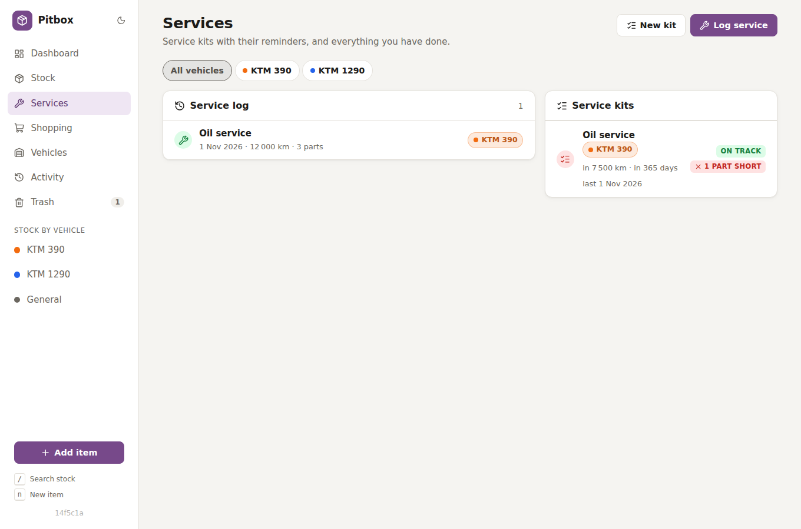
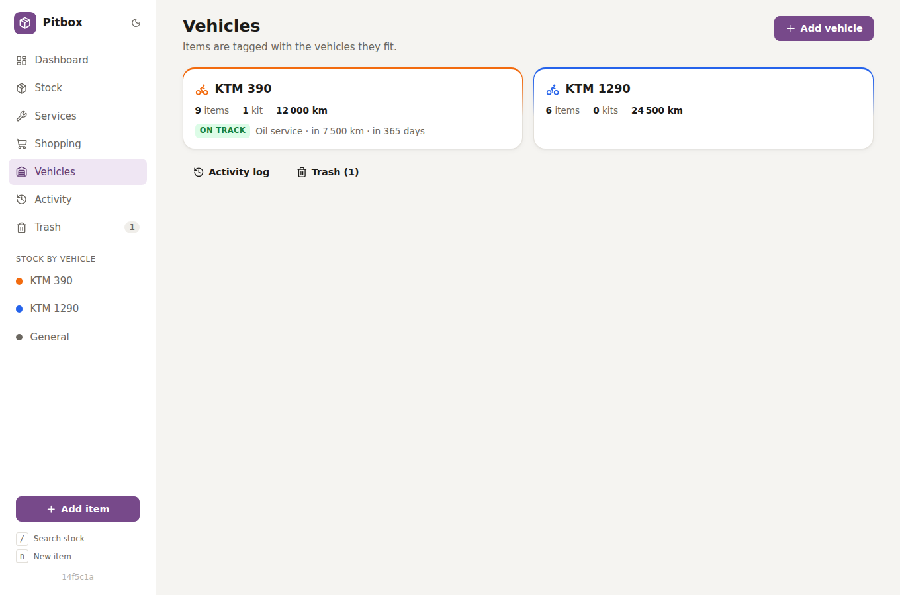

# Pitbox

A small, private garage app for your vehicles: the parts and fluids on the shelf, the service jobs they need and when they are due, and what to buy before the next one.

It is built for one household on a home network: no login, one binary, one Postgres database.

<picture>
  <source media="(prefers-color-scheme: dark)" srcset="docs/screenshots/desktop-dashboard-dark.png">
  
</picture>

## Features

- **Stock tagged by vehicle.** An item can fit one vehicle, several (e.g. an O-ring that fits both bikes), or none ("General" stock such as cleaners).
- **Pieces, ml/L and g/kg.** Type `525 ml`, `1.5 L`, `1,5 l` or `400g`. Quantities display the way you think about them (`6x`, `525 ml`, `1.5 L`).
- **Several SKUs per item:** the OEM number, the manufacturer number, one per pack size. Search finds items by any of them, with or without dashes, so a USB barcode scanner works too.
- **Stock view grouped like a shopping note:** per vehicle, then shared items, then general stock. Filter by vehicle (fits any / fits all), category, low stock or expiring. **Copy as text** gives you:
  ```
  KTM 390
  ------------
  1x - OEM Rear Brake Pads
  525 ml - Silkolene 15W50 PRO 4 XP
  ```
  CSV export is available too, with last prices and stock value, plus a CSV of the whole history.
- **Quick −/+** on every row, and a full **history** of every stock change (purchase, use, count, service) with prices and shops. Mistakes can be edited or deleted, and the stock follows.
- **Service kits.** For example, "KTM 390 – Oil service" lists the filter, 1.7 L oil and 2 O-rings. You see at once what is on the shelf and what is missing, and one click puts the shortfall on the shopping list.
- **Service log.** "Do this service" takes the parts from stock, records date, odometer and cost, and updates the vehicle's odometer. A logged service can be edited (parts, labour, odometer…) or deleted; its parts and odometer change follow.
- **Reminders:** kits can repeat every X km and/or Y months. The dashboard shows what is overdue or due soon.
- **Shopping list** with automatic suggestions: items below their minimum, and parts missing for kits. Ticking an entry off records the purchase (partial buys stay on the list), and something new you bought becomes a stock item in one step.
- **Prices from day one:** a new item can be saved with the price and shop you just bought it at, so it immediately has a last price and counts in the stock value and spending.
- **Undo everything:** every delete (and Bought) has an Undo, and the trash keeps it all until you empty it or permanently delete an entry.
- **Nothing disappears by accident:** items used in services, kits or purchases, and vehicles with services or kits, are archived instead of deleted, so history and spending stay correct, and they can be restored.
- **Saved once, never twice:** a double click, a retry on a bad connection ("Still saving… try again") or Back and Save never logs a service or a purchase twice, and a form opened in another tab can't overwrite newer changes.
- **Photos** of items (JPEG, PNG, GIF, WebP or HEIC; shrunk in the browser before upload, then by libvips on the server, and stored in Postgres), best-before dates, storage locations and notes.
- Works well on a phone in the garage, with dark mode and keyboard shortcuts (`/` search, `n` new item).

| Stock grouped by vehicle | Services and kits | Vehicles |
|---|---|---|
| <picture><source media="(prefers-color-scheme: dark)" srcset="docs/screenshots/desktop-stock-dark.png"></picture> | <picture><source media="(prefers-color-scheme: dark)" srcset="docs/screenshots/desktop-services-dark.png"></picture> | <picture><source media="(prefers-color-scheme: dark)" srcset="docs/screenshots/desktop-vehicles-dark.png"></picture> |

## Quick start

Requirements: [Go](https://go.dev/dl/) 1.27.3+, a PostgreSQL database (tested with 18), and for photos the libvips command line tools (`sudo apt install libvips-tools`; without them the app runs, logs a warning and refuses photo uploads). The Docker image has everything.

```bash
cp .env.example .env     # then fill in your database credentials
CGO_ENABLED=0 go build -ldflags "-X main.version=$(git describe --tags --always --dirty)" -o bin/pitbox ./cmd/pitbox
./bin/pitbox             # reads .env from the working directory, migrates the database and serves http://0.0.0.0:8080
```

Open `http://<this-machine>:8080` from any device on your network. Start by adding your vehicles, then your items.

The example `.env` uses the `public` schema, where the app keeps its data. A build with a version from a clean checkout, like the one above or the Docker image, runs on it. `go run ./cmd/pitbox`, a plain `go build` and a `-dirty` version are development builds and refuse `public`: develop with `DB_SCHEMA=dev` (see [docs/development.md](docs/development.md)).

Or run the published image, e.g. as a Portainer stack from [compose.yaml](compose.yaml): every push to `master` that passes CI becomes `latest`. See [docs/deployment.md](docs/deployment.md) for Portainer, plain Docker and systemd.

## Configuration

All settings come from environment variables or a `.env` file (real environment variables win):

| Variable | Default | Meaning |
|---|---|---|
| `DB_HOST`, `DB_PORT` | `127.0.0.1`, `5432` | Postgres server |
| `DB_DATABASE` | `stock_items` | Database name |
| `DB_SCHEMA` | `public` | Postgres schema. The real data lives in `public`; develop on a copy (`dev`): development builds refuse `public` unless `APP_ALLOW_PUBLIC_SCHEMA=1` |
| `DB_USERNAME`, `DB_PASSWORD` | `postgres`, empty | Credentials |
| `HOST`, `PORT` | `0.0.0.0`, `8080` | Where the web server listens |
| `APP_CURRENCY` | `EUR` | Label shown next to prices (up to 10 characters) |
| `APP_SKU_SEARCH_URL` | `https://www.google.com/search?q={q}` | Search engine for part number links: the number goes in place of `{q}`. Must be a full `http(s)://` URL with exactly one `{q}`, or the app won't start |
| `APP_SKU_SEARCH_PREFIX` | none | Added to every part number search, e.g. `site:de` |
| `APP_ALLOWED_HOSTS` | any | Host names and IPs the app answers to, comma-separated (ports ignored), e.g. `pitbox.lan,192.168.1.5`. Other names get 421, which keeps a web page whose name was pointed at your server (DNS rebinding) from using the app; `localhost` and loopback IPs always work |
| `TZ` | machine's zone | The app's zone, e.g. `Europe/Berlin`: when "today" starts (form dates, date checks, expiring, reminders, spending, "Deleted today") and the times pages show. Empty or unknown also means the machine's zone (an unknown name logs a warning). Timestamps are stored in UTC and the database's own zone doesn't matter |

`.env` is git-ignored. Never commit it.

## Development

```bash
scripts/check.sh      # gofmt, go mod tidy, vet, lint, unit + integration tests with coverage
cd e2e && npm ci && npx playwright install chromium && npx playwright test   # end-to-end (desktop + phone)
```

The integration and e2e tests use throwaway schemas (`test_*`, `e2e_*`) in the configured database and never touch your data. More in [docs/development.md](docs/development.md).

## Documentation

- [User guide](docs/user-guide.md): how to use the app day to day
- [Architecture](docs/architecture.md): how the code is organised
- [Data model](docs/data-model.md): tables and rules
- [Development](docs/development.md): setup, tests, adding features
- [Deployment](docs/deployment.md): Portainer, Docker, systemd, backups
- [Conventions](docs/conventions.md): rules for contributors and coding agents (see also [AGENTS.md](AGENTS.md))

## License

MIT. See [LICENSE](LICENSE). Icons from [Lucide](https://lucide.dev) (ISC). Includes [htmx](https://htmx.org) (Zero-Clause BSD).
